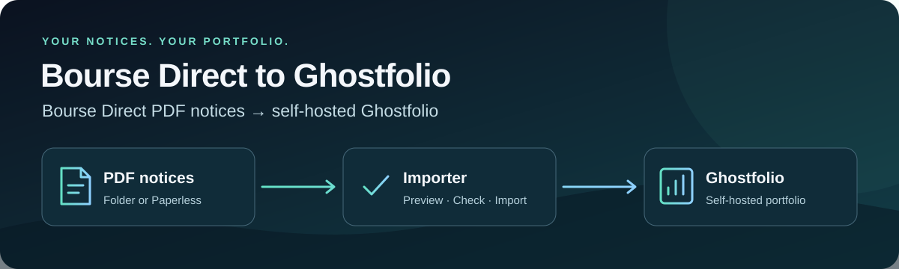

<p align="center">
  
</p>

<p align="center">
  <a href="https://github.com/flowcool/ghostfolio-boursedirect-sync/releases/latest"></a>
  <a href="https://github.com/flowcool/ghostfolio-boursedirect-sync/actions/workflows/offline-tests.yml"></a>
  <a href="https://github.com/flowcool/ghostfolio-boursedirect-sync/actions/workflows/codeql.yml"></a>
  <a href="LICENSE"></a>
</p>

<p align="center"><strong>Vos opérations Bourse Direct, dans votre Ghostfolio auto-hébergé.</strong><br>Déposez vos avis d'opéré PDF dans un dossier. Simulez. Importez. C'est fait.</p>

<p align="center">🇬🇧 <a href="README.md"><strong>English version</strong></a> · <a href="#démarrage-rapide">Démarrage rapide</a> · <a href="#configuration">Configuration</a> · <a href="https://github.com/flowcool/ghostfolio-boursedirect-sync/discussions">Questions</a> · <a href="https://github.com/flowcool/ghostfolio-boursedirect-sync/releases">Versions</a></p>

## Ce que fait l'outil

Bourse Direct n'a pas d'API publique. Mais il envoie un **avis d'opéré** PDF pour
chaque achat, vente et coupon. Cet importeur lit ces PDF originaux et crée les
activités correspondantes dans un compte [Ghostfolio](https://ghostfol.io) :
achats, ventes, frais et coupons, pour les comptes **PEA** et **PEA-PME** en EUR.

- 📁 Lit un simple dossier de PDF, ou un Paperless-ngx existant.
- 🧪 Simule par défaut. Rien n'est écrit tant que vous ne l'activez pas.
- 🔁 N'importe jamais deux fois le même avis, même après un renommage.
- 🔐 Aucune connexion au courtier. Il lit vos PDF et parle seulement à Ghostfolio.
- 🐳 Un seul conteneur Docker, amd64 et arm64, avec planification intégrée.

## Prérequis

- Docker avec Compose.
- Un Ghostfolio en service, avec un compte pour votre PEA (ou PEA-PME) Bourse Direct
  et un **Security Token** (Ghostfolio → Compte → Accès).
- Vos **avis d'opéré PDF originaux**, téléchargés depuis votre espace client
  Bourse Direct. Les scans ne sont pas pris en charge.
- Les nouveaux avis doivent arriver dans le dossier pour les exécutions suivantes.
  Téléchargez-les vous-même, ou automatisez avec un collecteur de documents.
  [Paperless-ngx](https://docs.paperless-ngx.com) peut remplacer le dossier comme source.

## Démarrage rapide

**1. Créez un dossier avec vos PDF et ce `compose.yaml` :**

```yaml
services:
  importer:
    image: ghcr.io/flowcool/ghostfolio-boursedirect-sync:latest
    restart: unless-stopped
    user: "10001:10001"
    read_only: true
    cap_drop: [ALL]
    security_opt: ["no-new-privileges:true"]
    tmpfs: ["/tmp:rw,noexec,nosuid,size=16m,mode=1777"]
    env_file: .env
    volumes:
      - ./notices:/notices:ro
```

Mettez les PDF dans `notices/`. Le conteneur tourne avec l'UID 10001 et doit pouvoir
les lire : `sudo chgrp -R 10001 notices && chmod -R g+rX notices`.

**2. Créez `.env` :**

```dotenv
GHOST_HOST=https://ghostfolio.example.com
GHOST_ACCESS_TOKEN=votre-security-token-ghostfolio
GHOST_ACCOUNT_NAME=Bourse Direct PEA
BD_ACCOUNT_REF=12345678
NOTICE_DIR=/notices
DRY_RUN=1
TZ=Europe/Paris
CRON=
```

**3. Simulez, puis importez :**

```sh
docker compose run --rm importer               # simulation : lisez les lignes proposées
docker compose run --rm -e DRY_RUN=0 importer  # import, une fois
```

Vérifiez le résultat dans Ghostfolio. Un second import ne doit rien créer.

**4. Planifiez :** mettez `DRY_RUN=0` et `CRON=0 6 * * *` dans `.env`, puis `docker compose up -d`.

Vous installez avec un assistant IA ? Donnez-lui [llms.txt](llms.txt).

## Configuration

| Variable | Obligatoire | Défaut | Valeurs et rôle |
| --- | --- | --- | --- |
| `GHOST_HOST` | oui | — | URL de Ghostfolio vue du conteneur : son URL normale, ou `http://ghostfolio:3333` si les deux services partagent un réseau Docker. |
| `GHOST_ACCESS_TOKEN` | oui | — | Security Token de Ghostfolio. |
| `GHOST_ACCOUNT_NAME` | oui | — | Nom exact du compte Ghostfolio cible. |
| `BD_ACCOUNT_REF` | oui | — | Référence après `COMPTE N°` sur un avis, sans espaces, sans `EUR` ni `PEA`. |
| `NOTICE_DIR` | source dossier | vide | `/notices`. Vide pour utiliser Paperless. |
| `PAPERLESS_URL`, `PAPERLESS_TOKEN` | source Paperless | vide | URL de Paperless-ngx et token en lecture seule. |
| `DRY_RUN` | non | `1` | `1` simule. `0` écrit dans Ghostfolio. |
| `CASH_BALANCE` | non | `0` | `1` gère les espèces depuis les relevés mensuels et les avis suivants. `0` conserve le solde. |
| `CRON` | non | vide | Planning à cinq champs, ex. `0 6 * * *`. Vide : une seule exécution. |
| `TZ` | non | — | Votre fuseau, ex. `Europe/Paris`. |
| `MAPPING_FILE` | non | vide | Fichier YAML monté, avec un bloc `symbol_mapping:` de correspondances `ISIN: TICKER`. Voir [mapping](config/README.md). |
| `IMPORT_CREATE_FROM` | non | vide | `AAAA-MM-JJ` : ne crée jamais d'activité avant cette date. |
| `APPRISE_URLS` | non | vide | Liste JSON d'URL [Apprise](https://github.com/caronc/apprise) pour les alertes. |
| `LOG_LEVEL` | non | `INFO` | `DEBUG`, `INFO`, `WARNING` ou `ERROR`. |

Pour gérer les espèces, mettez `CASH_BALANCE=1` et téléchargez le **relevé de compte**
mensuel dans la même source. Cela remplace le solde du compte Ghostfolio. Simulez
d’abord. Vous pouvez définir la plateforme facultative dans l’interface Ghostfolio.

Tous les réglages, la revue et la source Paperless : [référence de configuration](docs/configuration.md) (en anglais).

**Actions étrangères :** Bourse Direct les achète en EUR sur des places européennes.
Associez-les à la cotation en EUR, par exemple SAAB → `SDV1.F`, pas `SAAB-B.ST`.

## Sécurité

- L'outil ajoute des activités et n'en supprime jamais. Les changements d'activités existantes suivent les [règles de revue](docs/maintenance.md#operator-review-and-reconciliation).
- Un avis illisible ou une écriture incertaine arrête l'import. Rien n'est relancé à l'aveugle.
- Gardez votre token, vos PDF et vos logs privés.

## Limites

Avis PDF texte originaux de PEA et PEA-PME en EUR uniquement. Pas de CTO, pas de
relevés de titres, pas de scans, pas de conversion de devises. Les opérations sur
titres sont mises en attente pour revue manuelle. Une vente a besoin de l'avis de
son achat. Détails : [avis pris en charge](docs/supported-notices.md).

## Documentation

La documentation avancée est en anglais :
[Installation complète](docs/getting-started.md) · [Configuration](docs/configuration.md) ·
[Dépannage](docs/troubleshooting.md) · [Mise à jour](docs/upgrading.md) ·
[Toute la doc](docs/README.md) · [Contribuer](CONTRIBUTING.md)

Questions : [Discussions](https://github.com/flowcool/ghostfolio-boursedirect-sync/discussions) ·
Bugs : [Issues](https://github.com/flowcool/ghostfolio-boursedirect-sync/issues)

## Licence

[MIT](LICENSE).
