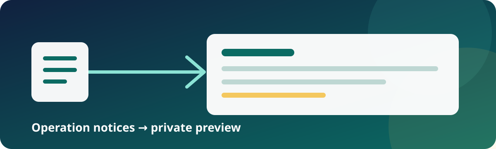

<div align="center">



# Bourse Direct → Ghostfolio

**Collect recent Bourse Direct operation notices and review a Ghostfolio preview.**

This Docker Compose connector keeps the original documents and a private report
on your machine. It helps you inspect what a later import could contain; it does
not change your portfolio.

[](https://github.com/flowcool/ghostfolio-boursedirect-sync/releases/latest)
[](https://github.com/flowcool/ghostfolio-boursedirect-sync/actions/workflows/offline-tests.yml)
[](#quick-start)
[](#requirements)
[](#preview-only)
[](LICENSE)

[Quick start](#quick-start) · [Configuration](#configuration) · [Review a dry run](#review-a-dry-run) · [Troubleshooting](#troubleshooting) · [Contributing](CONTRIBUTING.md)

</div>

> **Important:** Bourse Direct locks an account after three failed logins. This
> connector never retries a failed login automatically. Stop and investigate an
> unsuccessful attempt instead of running it again.

This is an unofficial community project, unaffiliated with Bourse Direct and
Ghostfolio. Broker websites and policies can change without notice; assess that
risk and keep your own backups before using it.

## Who this is for

Use the released Compose bundle if you run Ghostfolio already, have a Bourse
Direct PEA or PEA-PME, and want to review recent operation notices privately.
You need a Bitwarden-compatible vault, a dedicated Bourse Direct login item, and
an existing Ghostfolio account.

## Preview only

v0.1.0 reads a rolling 90-day window of available operation notices, saves them
with a Ghostfolio snapshot, and creates a dry-run report. It never creates,
updates, or deletes financial records, and it does not schedule itself. The
window is not complete account history or a cost-basis reconstruction. Currency
and security mappings must be supplied explicitly; the connector does not guess
them or convert corporate actions such as subscription rights.

Future releases may add capabilities only through a separately reviewed release.
Until then, writes and scheduling remain out of scope.

## How it works

1. The connector opens one vault session and reads the selected Bourse Direct
   login item.
2. It connects once, lets you select a PEA or PEA-PME and an existing Ghostfolio
   account when needed, then saves that pair in its private state volume.
3. It downloads the available operation notices, closes the session, and compares
   the saved documents with a Ghostfolio snapshot.
4. It writes a report for you to review. Missing mappings, unsupported operations,
   or uncertain results remain visible; none become financial writes.

The private state volume keeps the selected account pair, source documents,
receipts, reports, and safety journals. A journal records an unfinished attempt
so it cannot be bypassed by repeatedly trying a login.

## Requirements

- Linux on Intel/AMD (**AMD64**) with Docker Engine and Docker Compose v2.
- A Bitwarden-compatible HTTPS vault with a personal API key and master password.
- One uniquely named login item containing your Bourse Direct login, password,
  and TOTP setup, normally named `boursedirect.fr`.
- Ghostfolio, an existing destination account, and its long-lived **Security
  Token**.
- About 1.5 GiB of container memory and outbound access to the vault, broker,
  and configured Ghostfolio origin.

The release includes the qualified browser and Bitwarden CLI. No local Python,
Node.js, browser installation, Docker socket mount, or published port is needed.
The published release is AMD64-only. CI also performs non-publishing ARM64 build
checks; that does not make ARM64 a supported connection path.

## Quick start

1. Download **`ghostfolio-boursedirect-sync-v0.1.0.tar.gz`** and
   **`SHA256SUMS`** from [the release](https://github.com/flowcool/ghostfolio-boursedirect-sync/releases/tag/v0.1.0), then verify and unpack it:

   ```bash
   sha256sum -c SHA256SUMS
   tar -xzf ghostfolio-boursedirect-sync-v0.1.0.tar.gz
   cd ghostfolio-boursedirect-sync-v0.1.0
   ```

2. Create a private environment file and fill in the required vault and
   Ghostfolio settings described in [Configuration](#configuration):

   ```bash
   cp .env.example .env
   chmod 600 .env
   ```

3. Pull the exact released image:

   ```bash
   docker compose pull
   ```

4. Start one interactive connection and keep the terminal attached. If account
   fields are blank, choose the offered source and destination accounts:

   ```bash
   docker compose run --rm bitwarden connect
   ```

5. Read the JSON line in the terminal and the report saved in the persistent
   volume. See [Review a dry run](#review-a-dry-run).

`bitwarden` is the retained Compose service name because it includes the
Bitwarden CLI. It is the whole connector, not a Bitwarden server. Likewise,
`bitwarden-binding` is the connector's persistent state volume; it stores more
than the vault binding.

The Compose project pins
`ghcr.io/flowcool/ghostfolio-boursedirect-sync:v0.1.0`. Keep
`collector/browser-seccomp.json` beside the Compose files: the archive includes
it and the browser sandbox requires it.

## Configuration

| Setting | Purpose |
| --- | --- |
| `BW_SERVER` | Canonical HTTPS vault origin; default `https://vault.bitwarden.com` |
| `BW_CLIENTID`, `BW_CLIENTSECRET` | Bitwarden personal API credentials |
| `BW_PASSWORD` | Vault master password |
| `BW_ITEM_NAME` | Exact, unique login-item name; default `boursedirect.fr` |
| `GHOSTFOLIO_ORIGIN` | Ghostfolio HTTPS origin, without path, query, or fragment |
| `GHOSTFOLIO_SECURITY_TOKEN` | Permanent Security Token; not an expiring JWT |
| `BD_SOURCE_ACCOUNT_REF` | Optional exact source reference, for example `ABC12345 PEA` |
| `GHOSTFOLIO_ACCOUNT_ID` | Optional existing destination account ID |
| `BOURSEDIRECT_IMAGE` | Optional image override for a deliberate upgrade or rollback |

Leave both account fields blank to select them in the terminal, or supply the
exact account references. The first successful selection is retained. A later
conflict stops the run; changing `.env` cannot silently route a saved account
pair elsewhere.

Put verified mappings in **`config/mappings.yaml`**. The directory is mounted
read-only. A missing mapping is reported in the dry run while acquisition can
still save the documents. See the [mapping format](config/README.md).

Keep `.env`, mappings, and the state volume private. Docker administrators can
inspect container environment variables. Never publish documents, credentials,
account identifiers, or report contents in an issue or pull request.

### Ghostfolio on a private Docker network

This optional setup is for an existing Ghostfolio service called
`ghostfolio:3333` on a trusted private Docker network. It is outside the normal
quick-start flow:

```dotenv
GHOSTFOLIO_ORIGIN=http://ghostfolio:3333
GHOSTFOLIO_NETWORK=your-existing-private-network
```

Use the overlay for both commands:

```bash
docker compose -f compose.yaml -f compose.ghostfolio.yaml pull
docker compose -f compose.yaml -f compose.ghostfolio.yaml run --rm bitwarden connect
```

The network must already exist and resolve `ghostfolio` to your trusted service.
Only this exact HTTP origin is accepted, and its connected peer must have an
RFC1918 address before credentials are sent. Other HTTP origins and redirects
are refused. The default Compose project does not join a production network.

## Review a dry run

The terminal prints one JSON summary. This synthetic example has no personal
account number, document, or portfolio data:

```json
{"code":"COMMUNITY_DRY_RUN_COMPLETED","contract_notes":[],"source_mode":"notices","source_activities":3,"skipped_operations":0,"unresolved_exceptions":1,"import_ready":false,"blockers":["FINANCIAL_APPLICATION_NOT_AUTHORIZED"],"report":"outputs/daily-notices-example-account.yaml"}
```

| Exit code | Meaning |
| --- | --- |
| `0` | Dry run completed without unresolved source exceptions |
| `2` | Dry run completed; the report contains exceptions to review |
| `1` | Connection, configuration, or processing failed |

A completed dry run remains a preview, whatever its exit code. Review exceptions
before considering any later import. Currency conflicts, missing mappings,
unsupported operations, and existing-record differences remain visible.

The `bitwarden-binding` volume retains:

- `community-binding.yaml`: the selected source/destination pair.
- `runs/<run-id>/`: original documents, destination snapshots, and acquisition receipts.
- `outputs/daily-notices-<account-key>.yaml`: the detailed private report.
- `state/`: journals that preserve identity and stop uncertain attempts from being rerun.

The report is YAML. Its exact content depends on your private data; this excerpt
uses entirely synthetic values:

```yaml
schema_version: 1
source_mode: notices
as_of: 2026-10-12
window:
  first: 2026-07-14
  last: 2026-10-12
import_ready: false
blockers:
  - FINANCIAL_APPLICATION_NOT_AUTHORIZED
activities:
  BD#v1#example-account#example-event:
    kind: BUY
    symbol: EXAMPLE.PA
exceptions:
  - SECURITY_MAPPING_MISSING
```

To copy retained files into a private local directory without another connection
attempt:

```bash
install -d -m 700 saved-run
docker compose run --rm --no-deps --entrypoint /bin/sh \
  -v "$PWD/saved-run:/export" bitwarden -c 'cp -a /state/. /export/'
```

The export directory must be writable by UID/GID 1000, used by the container.
Preserve the whole volume for backups and reuse the same Compose project directory
for deliberate later launches. `docker compose down -v` removes this history.

## Troubleshooting

| Symptom | Check |
| --- | --- |
| Account selection requires a terminal | Run interactively or configure both exact account fields |
| Saved account conflicts with configuration | Restore the intended settings; do not silently replace the binding |
| Missing security mapping or currency conflict | Review the report and verified per-ISIN mapping |
| Exit `2` | Read the diagnostic report; this is a completed preview with exceptions |
| Vault item cannot be resolved | Check the exact item name, uniqueness, and stored TOTP setup |
| HTTP origin refused | Use HTTPS, or the exact private-network setup documented above |
| Browser sandbox fails | Keep the supplied seccomp profile and Compose capabilities |
| An unfinished authentication attempt blocks another run | Retain its journal and inspect the failure before an explicit recovery |

Do not loop failed broker logins or remove authentication journals to bypass a
fence. A successfully closed session permits a later deliberate launch; it does
not enable automatic retries or scheduling.

The optional `docker compose run --rm bitwarden inspect` checks vault item
identity and logout without submitting credentials to Bourse Direct.

## Documentation and development

- [Documentation map](docs/README.md): start here for user, contributor, and auditor material.
- [Contributing](CONTRIBUTING.md): local builds and synthetic verification.
- [Release process](docs/operations/releasing.md) and [changelog](CHANGELOG.md).
- [Design contracts](docs/design/index.md): current acquisition, account, financial,
  preview, and recovery boundaries.

The project uses the terms in its [MIT Non-AI License](LICENSE). The bundled
browser includes third-party components; see the
[Playwright Apache 2.0 license](collector/licenses/playwright-LICENSE) and its
attribution notices. See the [build and release guarantees](.github/BUILD.md)
for image scanning and artifact publication.
