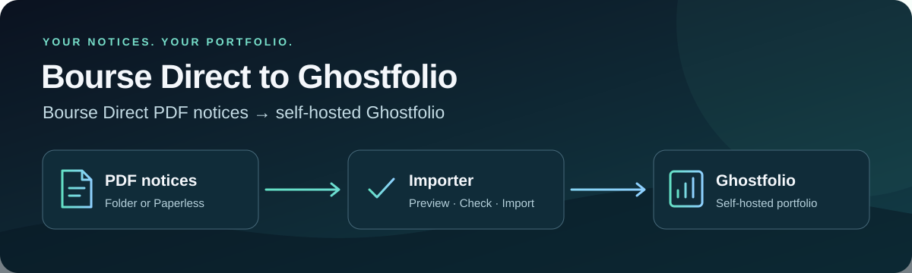

<p align="center">
  
</p>

<p align="center">
  <a href="https://github.com/flowcool/ghostfolio-boursedirect-sync/releases/latest"></a>
  <a href="https://github.com/flowcool/ghostfolio-boursedirect-sync/actions/workflows/offline-tests.yml"></a>
  <a href="https://github.com/flowcool/ghostfolio-boursedirect-sync/actions/workflows/codeql.yml"></a>
  <a href="LICENSE"></a>
</p>

<p align="center"><strong>Your Bourse Direct notices, together in self-hosted Ghostfolio.</strong><br>Preview your imports. Check the result. Keep your portfolio current.</p>

<p align="center"><a href="#quick-start">Quick start</a> · <a href="#what-it-does">What it does</a> · <a href="#safety-first">Safety</a> · <a href="docs/configuration.md">Configuration</a> · <a href="docs/troubleshooting.md">Troubleshooting</a> · <a href="https://github.com/flowcool/ghostfolio-boursedirect-sync/releases">Releases</a></p>

## What it does

Import buys, sells and coupons from original Bourse Direct PDF notices into
one [Ghostfolio](https://ghostfol.io) account. Supports EUR PEA and PEA-PME.
Run with Docker. No source checkout or local build is needed.

## Key features

- Use your PDF folder or an existing Paperless-ngx service.
- Preview before importing. Simulation is the default.
- Avoid duplicates, even after renaming files or switching sources.
- Keep broker credentials out of the importer. No broker login or vault access.
- Run on Linux amd64 or arm64 with the same Docker setup.
- Automate with a schedule and optional Apprise notifications.
- Find missing activities with a notice coverage report.

### Deliberate boundaries

Original text-bearing notices only. No broker collection, OCR scans or FX conversion.
Share-count changes stop the affected security. See [supported notices and limits](docs/supported-notices.md).

## How it works

Read original PDFs from a folder or Paperless. Match securities and compare existing
Ghostfolio activities. Simulation shows proposed imports and required actions.
Live mode adds activities and confirms each write. Corrections follow separate [review rules](docs/maintenance.md#operator-review-and-reconciliation).

## Quick start

You need Docker Compose and a reachable Ghostfolio instance with a backup procedure.

1. Choose a [release](https://github.com/flowcool/ghostfolio-boursedirect-sync/releases/latest). Download and verify its operator bundle in Bash. Stop on any failure; require checksum `OK` before extraction.

   ```bash
   umask 077
   read -r -p "Release version (without v): " version
   release="https://github.com/flowcool/ghostfolio-boursedirect-sync/releases/download/v$version"
   curl --fail --location --remote-name "$release/ghostfolio-boursedirect-sync-v$version.tar.gz"
   curl --fail --location --remote-name "$release/SHA256SUMS"
   sha256sum --check SHA256SUMS --ignore-missing
   tar -xzf "ghostfolio-boursedirect-sync-v$version.tar.gz"
   cd "ghostfolio-boursedirect-sync-v$version"
   cp .env.example .env
   chmod 600 .env
   sudo install -d -m 0700 -o 10001 -g 10001 review
   ```

2. [Configure Ghostfolio and one source](docs/getting-started.md#2-set-ghostfolio-and-choose-one-source) in `.env`. Keep `DRY_RUN=1` and `CRON=`. Check PDF access and security mapping.
3. Simulate. Read the private log and [check coverage](docs/getting-started.md#3-simulate-and-inspect).

   ```sh
   docker compose config --quiet
   docker compose pull
   docker compose run --rm -T --no-deps -e DRY_RUN=1 -e CRON= importer > simulation.log 2>&1
   echo "Exit status: $?"
   less simulation.log
   ```

4. Verify your backup. Resolve required actions. Import once, inspect Ghostfolio, then [verify duplicates and enable scheduling](docs/getting-started.md#4-import-once-verify-then-schedule).

   ```sh
   docker compose run --rm -T --no-deps -e DRY_RUN=0 -e CRON= importer > import.log 2>&1
   echo "Exit status: $?"
   less import.log
   ```

Follow [Getting started](docs/getting-started.md) for the full procedure.
Vous utilisez les « avis d'opéré » Bourse Direct : gardez les PDF originaux.

## Safety first

- Back up Ghostfolio before writes. An image rollback does not undo imports.
- Simulation sends no financial writes. Sources stay read only in every mode.
- Imports never delete activities. Review corrections before enabling writes.
- Keep tokens, original PDFs, logs and the complete review directory private and outside Git.
- Stop on an uncertain write. Keep all journals. Follow [recovery](docs/troubleshooting.md) before another run.
- Use one service and review directory per source/target account. Stop scheduling before manual runs.

## Docker image

`ghcr.io/flowcool/ghostfolio-boursedirect-sync:latest` tracks the stable release.
Pin `@sha256:...` for controlled upgrades. The operator bundle already pins its qualified image.
Startup reports `ghostfolio-boursedirect-sync version X.Y.Z — commit <12-character SHA>`.

## Limitations

No CTO, account statements or automatic corporate-action treatment. Missing earlier
buys can block sells. Notices cannot prove complete history or a fiscal cost basis.
Read [supported notices](docs/supported-notices.md) and [upgrade and rollback rules](docs/upgrading.md).

## Documentation

[Installation](docs/getting-started.md) · [Configuration](docs/configuration.md) · [Troubleshooting](docs/troubleshooting.md) ·
[Advanced reference](docs/README.md) · [Contributing](CONTRIBUTING.md) · [Questions and bugs](https://github.com/flowcool/ghostfolio-boursedirect-sync/issues) ·
[Releases](https://github.com/flowcool/ghostfolio-boursedirect-sync/releases) · [Changelog](CHANGELOG.md)

## License

[MIT NON-AI License](LICENSE). Includes additional restrictions. Read it before use or contribution.
